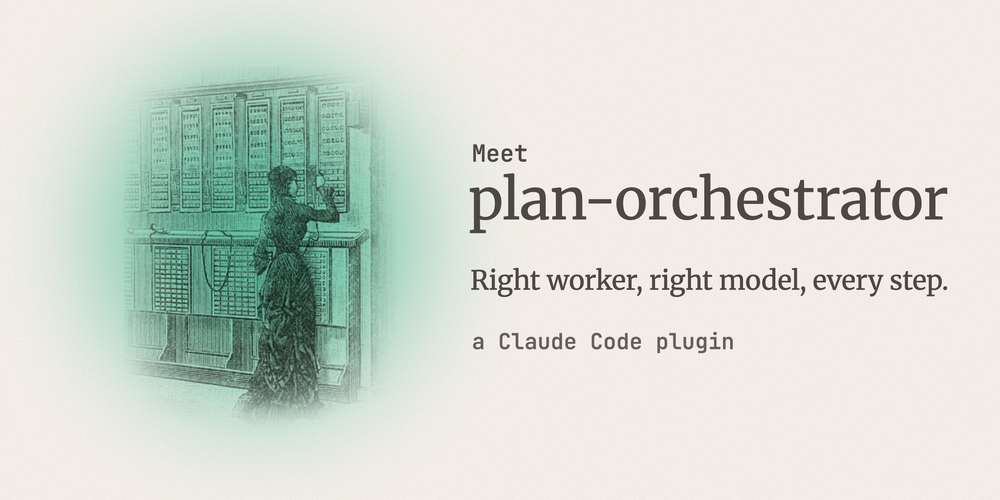

# plan-orchestrator

After you approve a plan in Claude Code, the route skill decides how each step runs and the cheapest model that can do
it well, checks every result itself, and tracks progress on a board. Without it, in two test runs of a 7-step plan,
Claude Code gave none of its 6 subagents a model and did the mechanical steps itself on Opus 5.5.

## Install

```
/plugin marketplace add lijingwu2026/claude-code-plan-orchestrator
/plugin install plan-orchestrator@plan-orchestrator
```

On enable, Claude Code asks where the board lives (default `PROGRESS.md`). The hooks need `python3`.

Then use plan mode as usual; the route skill only asks you when a decision is yours.

<picture>
  <source media="(prefers-reduced-motion: reduce)" srcset="docs/route-loop-static.svg">
  
</picture>

## What the route skill decides

For each step: how it runs (in the main session, a subagent, a script, a retry loop, an agent team or another
session), on which model, and the check.

- **Parallel** unless steps edit the same file, must talk to each other, or need another step's output.
- **Mechanical work → the cheapest model that can do it; judgment → the top model.** A review never runs on the model
  that did the work.
- **Done** only when the route skill has run the step's check itself.

Claude Code runs subagents and compacts; the board lives outside the conversation, so the route skill reads it
afterwards and carries on.

Full rules: [docs/how-route-decides.md](docs/how-route-decides.md).

## What you see before anything runs

From a test run of a 7-stage release plan (stage 1, a naming debate, is split into 1a–1c):

| Stage | Split | Executor | Model | Check | Why |
|---|---|---|---|---|---|
| 1a. Argue cases (opening) | spawn 2 | subagent: general-purpose | opus | each returns a case for its name | judgment; the two cases are independent |
| 1b. Rebuttals | spawn 2 (serial after 1a: it needs the 1a output) | subagent: general-purpose | opus | each answers the other's strongest objections | needs the new data from 1a |
| 1c. Decide + write naming-decision.md | serial after 1b | inline | Opus 5.5 | `grep -c '^Decision:'` = 1 | one Write that combines the returned arguments in this session |
| 2+3. Rename in code + usage.md | spawn 1 (one worker for both chains) | subagent: general-purpose | sonnet | unittest OK; grep count 0 | mechanical; different files; after 1c |
| 4. Setext→ATX on 10 pages | script | script | — | grep prints nothing | deterministic and mechanical |
| 5. README rewrite | loop | subagent: general-purpose | sonnet | readability PASS | revise-until-threshold; independent |
| 6. Review stages 2–4 | spawn 1 | subagent: general-purpose | opus (producers were sonnet + script) | verdict + unittest OK | independent review on a different model |
| 7. CHANGELOG 1.1.0 | serial after 6 | inline | Opus 5.5 | grep `## 1.1.0` = 1 | one Edit, after the review |

Split: spawn N = N subagents in parallel; loop = revise until the check passes. inline = the main session; opus, sonnet = a subagent's model.

## Evidence

**The same 7-stage plan, with and without the route skill** (2 runs each, Claude Code 2.1.289):

| | Without | With |
|---|---|---|
| Subagents given a model (total started, 2 runs) | 0 of 6 | 10 of 10 |
| Mechanical rename and docs stages ran on | Opus 5.5, main session | Sonnet subagent |
| Review on a different model | 0 of 2 | 2 of 2 |
| Cost of the run | $1.52, $1.26 | $1.71, $1.68 |

On this small plan the route skill cost 22% more (mean $1.70 vs $1.39): Opus cost did not fall ($1.54 per run with
it; $1.52, $1.26 without), and Sonnet's $0.13–0.17 of mechanical work came on top.

**Real use** (34 of the author's sessions, earlier version): subagent work dispatched after the route skill ran cost
$1,232 on Sonnet at API rates, against $2,070 for the same tokens priced at Opus 5.5. The skill's own cost, scaled to this release's longer text,
was about $34 (at most $64). The author's setup also had other rules sending work
to Sonnet, so this shows the overhead is small, not the saving the route skill alone caused.

**After compaction:** with the compaction window forced down to 100k tokens, a six-stage plan got through 3–4
compactions in 6 of 6 test runs (2 on the shipped text), with no step started twice.

Method and limits: [docs/evidence.md](docs/evidence.md).

## FAQ

**What does it write in my project?** The board, one row per step; a `handoffs/` file only when a plan moves to a new
session.

**What if Claude doesn't start it?** Ask Claude to use the route skill.

**How do I turn it off?** There is no per-plan switch: `claude plugin disable plan-orchestrator`, or `claude plugin
uninstall plan-orchestrator`.

## Compared with two similar tools

The two most-starred tools where a lead model hands work to cheaper models (their READMEs, 2026-10-04).

| | plan-orchestrator | pilotfish | fable-foreman |
|---|---|---|---|
| Who-does-what table first | yes, per step | not in README (fixed roles) | not in README (routing card per machine) |
| Checking results | each step's check | fresh verifier at risky points | lead "personally verifies critical behavior" |
| Stronger than this plugin at | — | benchmarks with stated limits | other vendors' models; a 15-scenario test suite |

## Limits

- Small plans cost more; the break-even plan size was not measured.
- Compaction was tested on one 6-stage plan only.
- Nothing machine-checks the allocation table; the hooks remind, they can't force.
- Tested on Opus 5.5, Claude Code 2.1.288–2.1.289.

## More

[Board and settings](docs/board-and-settings.md) · [Handoff](docs/handoff.md)

## License

MIT
